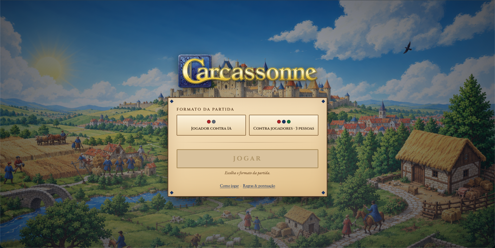
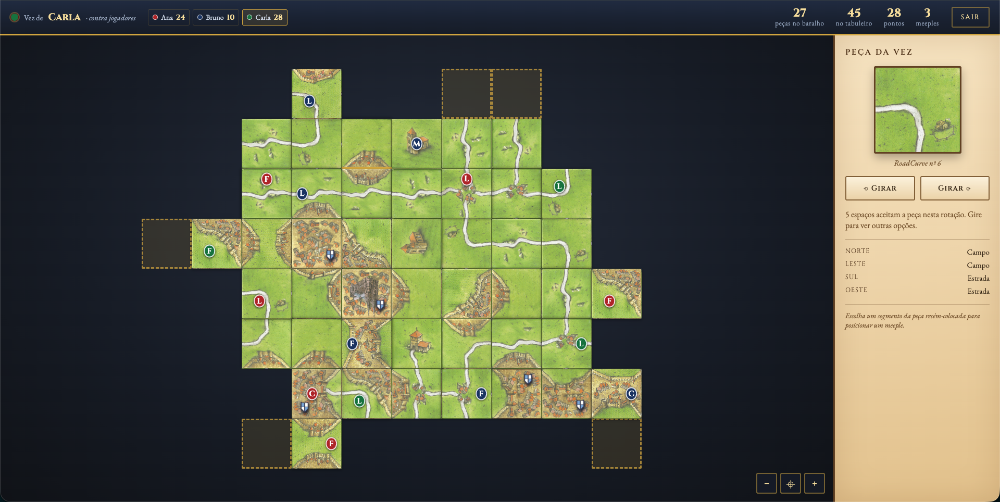

# Carcassonne

Versão web do jogo de tabuleiro Carcassonne, com servidor em Java e interface em
HTML, CSS e JavaScript. Jogue contra a IA ou com outras pessoas no mesmo
dispositivo.

<p align="center">
  
  
</p>

## Como rodar

Só precisa de um JDK 21 ou mais novo — nenhuma dependência externa.

No macOS ou Linux:

```sh
./run.sh          # compila e sobe em http://localhost:8080
./run.sh 9000     # ou em outra porta
```

No Windows, abra o PowerShell nesta pasta e use:

```powershell
.\run.bat         # compila e sobe em http://localhost:8080
.\run.bat 9000    # ou em outra porta
```

Mantenha o terminal aberto enquanto joga e acesse o endereço mostrado.

## Modos de jogo

Na tela inicial, escolha o formato da partida:

- **Jogador contra IA:** de 1 a 4 pessoas e de 1 a 4 IAs, com 2 a 5 participantes
  no total. Informe o nome de cada pessoa; as IAs jogam seus turnos
  automaticamente.
- **Contra jogadores:** três pessoas jogam em turnos no mesmo dispositivo. Informe
  o nome de cada uma.

Os links **Como jogar** e **Regras & pontuação**, na mesma tela, explicam as
regras.

## Testes

Para conferir as regras do modelo sem abrir o navegador, no macOS ou Linux:

```sh
javac -d build $(find src/java -name '*.java')
java -cp build carcassonne.Principal --testes
```

No Windows, pelo PowerShell:

```powershell
javac -d build src\java\carcassonne\*.java src\java\carcassonne\modelo\*.java src\java\carcassonne\controle\*.java src\java\carcassonne\visao\*.java
java -cp build carcassonne.Principal --testes
```

## Estrutura

```
.
├── run.sh                  compila e sobe o servidor
├── run.bat                 inicializador equivalente para Windows
├── README.md
├── src/
│   ├── java/               código Java
│   │   └── carcassonne/
│   │       ├── modelo/     regras do jogo e estratégias (humana e IA) — não conhece tela nem HTTP
│   │       ├── controle/   orquestração da partida e dos turnos da IA
│   │       ├── visao/      servidor HTTP, rotas /api e JSON
│   │       ├── Principal   ponto de entrada
│   │       └── Testes      conferência das regras
│   └── web/                interface
│       ├── index.html  index.css  index.js     tela inicial
│       └── jogo.html   jogo.css   jogo.js      tela de partida
├── assets/                 imagens do jogo
│   ├── marca/              logo e fundo da tela inicial
│   └── tiles/              as 20 cartelas e o brasão (ver CREDITOS.md)
├── docs/                   documentação
│   ├── requisitos.md       requisitos do trabalho
│   └── capturas/           capturas de tela usadas neste README
└── build/                  gerado pela compilação (fora do git)
```

Cada pasta tem um único papel: `src` guarda o que é escrito por nós, `assets` o
que é conteúdo, `docs` o que é documento e `build` o que é descartável. Para o
navegador, `src/web` e `assets` aparecem como uma árvore só — a página fica em
`/jogo.html` e as cartelas em `/assets/tiles/`.
